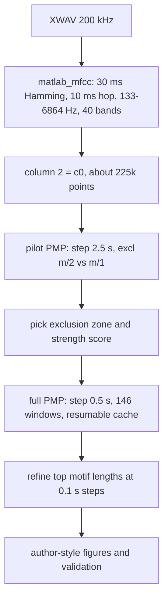

# Exact replication with MATLAB-style MFCC (10 ms resolution)

Reproduce the author's pipeline exactly: a numpy port of MATLAB's default `mfcc()` at the native 200 kHz rate and 10 ms hop, taking column 2 (c0 after the prepended log-energy). Then compute a resumable, cached pan matrix profile on the roughly 225k-point series, select the exclusion zone and strength definition that reproduce 93.5 s at 32.8 min and 82.1 s at 10.4 min, refine motif lengths to 0.1 s, and redraw the figures in the author's style.

## Tasks
- [ ] Create `Whales_Song/whale_mfcc.py`: `read_xwav`, `matlab_band_edges`, chunked `matlab_mfcc` (native 200 kHz, 30 ms Hamming, 10 ms hop, magnitude, 40 Slaney mel bands, log, ortho DCT, log-energy prepended), resumable `compute_pan_mp`
- [ ] Compute and cache MATLAB-style MFCC; verify 224,998 frames and that column 2 (c0) looks like the image strip
- [ ] Pilot PMP at 2.5 s steps for exclusion zone m/2 vs m/1; compare Pearson vs length-weighted strength against 93.5 s @ 32.8 min and 82.1 s @ 10.4 min
- [ ] Run full resumable PMP (2750..10000 step 50) with the chosen exclusion zone and cache it
- [ ] Extract top-3 motifs and refine their lengths at 0.1 s steps (+/- 2 s)
- [ ] Build `Whale_Song_Replication_MATLAB_MFCC.ipynb` with author-style strip, red/blue and purple/green overlays, 3D jet surface, heatmap, and validation table; execute it

## What we know about the author's pipeline
- MATLAB `mfcc(audioIn, fs)` defaults, confirmed in the MathWorks documentation:
  - Window: `hamming(round(0.03*fs), "periodic")`, which is 6000 samples at 200 kHz.
  - Overlap: `round(0.02*fs)`, so the hop is 2000 samples, or 10 ms.
  - FFT length equals the window length. Frames are not centered, so frame k starts at sample `k*2000`.
  - 13 coefficients, with `LogEnergy="append"`. Column 1 is therefore log-energy and **column 2 is c0**.
  - `BandEdges` is the 42-edge Slaney design: 13 linearly spaced edges from 133.33 Hz in 66.67 Hz steps, then 29 log-spaced edges (factor 1.0711703) up to about 6864 Hz. That gives 40 half-overlapping triangular filters.
- The time series therefore has about 225,000 points (100 per second). Motif lengths of 27.5 s to 100 s become `m = 2750 ... 10000`.
- The Matrix Profile XX paper ranks motifs of different lengths by length-normalized Euclidean distance, which it describes as equivalent to Pearson correlation. It uses an exclusion zone of m/2. In the figure, the top-1 pair is two adjacent, non-overlapping performances near 32.8 minutes.
- Measured runtime: one exact `stumpy.stump` on 225k points with m = 5000 takes about 18 s on a 32-core machine (no CUDA available). A full run at 0.5 s steps (146 windows) is therefore about 45–60 minutes, so the computation must be resumable and cached.

## Files
- New helper module `Whales_Song/whale_mfcc.py`, reusable later for the multi-scale experiments:
  - `read_xwav(path)` returns `(memmap, fs)` by walking the RIFF chunks and skipping `harp`. This code moves out of the existing notebook.
  - `matlab_band_edges()` returns the 42 Slaney edges.
  - `matlab_mfcc(x, fs, ...)` is a chunked numpy port of MATLAB's default `mfcc`. It returns `coeffs` in MATLAB column order, including log-energy as column 1. Steps:
    - Frame at native 200 kHz in chunks of about 5000 frames, using `np.lib.stride_tricks.sliding_window_view` on the memmap.
    - Apply the periodic Hamming window, `rfft(n=6000)`, then take the magnitude spectrum.
    - Apply the triangular mel filter bank built from the band edges.
    - Take `log(max(., realmin))`, then the orthonormal DCT-II (`scipy.fft.dct(..., norm="ortho")`), keeping 13 coefficients.
    - Compute log-energy as `log(sum(frame**2))`.
  - `compute_pan_mp(T, ms, cache_path, excl_denom)` is a resumable wrapper around `stumpy.stimp(percentage=1.0)`:
    - It saves `_PAN`, `M_`, and `n_processed` to an `.npz` file every 5 window sizes.
    - On restart it restores them and continues in the same breadth-first order.
    - It sets `config.STUMPY_EXCL_ZONE_DENOM` from `excl_denom`.
    - It can also be run as a script, `python whale_mfcc.py`, so the long computation can run in a terminal.
- New notebook `Whales_Song/Whale_Song_Replication_MATLAB_MFCC.ipynb`. The existing `Whale_Song_Pan_Matrix_Profile.ipynb` stays as the fast exploratory version.

## Notebook flow

1. **MFCC**: run `matlab_mfcc` on the full file and cache the result to `whale_mfcc_matlab.npz`. Plot column 1 (log-energy) and column 2 (c0) over the full 37.5 minutes. Sanity checks: frame count `floor((N - 6000) / 2000) + 1 = 224,998`, and the 32.8-minute region should look like the image's spiky trace.
2. **Pilot** (about 10 minutes per setting): compute the pan matrix profile with window sizes from 2750 to 10000 in steps of 250 (2.5 s), once with exclusion zone m/2 (the paper's choice) and once with m/1. For each, report the strongest motif pair under two strength scores: Pearson correlation `rho = 1 - d^2/(2m)`, and the length-weighted margin `sqrt(m/max_m) * (1 - d/(2 sqrt m))` used in the current notebook. Pick the combination that puts the top-1 motif near 93.5 s at about 32.8 minutes (adjacent, non-overlapping pair) and the top-3 motif near 82.1 s at about 10.4 minutes.
3. **Full pan matrix profile**: use window sizes from 2750 to 10000 in steps of 50 (0.5 s), which is 146 windows, with the chosen exclusion zone. The run is resumable and cached in `whale_pan_mp_matlab_cache.npz`; the notebook notes that it can instead be run via the script in a terminal.
4. **Top motifs**: extract them with the same masking approach as before (take the strongest point on the surface, look up its nearest neighbor, mask both occurrences across all lengths, repeat 3 times). Then **refine** each motif's length by running `stumpy.stump` at every 0.1 s step within plus or minus 2 s of its coarse length, and keep the best length. This is about 40 runs, roughly 12 minutes per motif.
5. **Figures in the author's style**:
   - Full-length strip titled "37.5 minutes (MFCC coefficient 2)", with the top-1 occurrence highlighted in red and the top-3 in blue, and minute labels.
   - Top-1 overlay in red and blue, captioned "Top 1 motif is X seconds long".
   - Top-3 overlay in purple and green, captioned "Top 3 motif is X seconds long".
   - 3D jet-colormap surface with motif lengths from 27.5 s (front) to 100 s (back), the same viewing angle, and a time axis decimated for rendering. Plus the top-down heatmap.
6. **Validation table**: compare length, start minutes, and correlation for top-1 and top-3 against 93.5 s / 32.8 min and 82.1 s / 10.4 min. Also print the strongest ridge length near 10.4 and 32.8 minutes. State plainly whether the exact numbers matched, and if not, how far off they are.

## Notes
- c0 is invariant to per-band constant gains under z-normalization, so the filter-bank normalization option does not change the result. Using the magnitude spectrum rather than power follows MATLAB `mfcc`.
- The multi-scale experiments (unit 5–10 s, phrase 30–60 s, theme 1–3 min, song 5–10 min) are out of scope for this plan. The helper module is designed so they can reuse `matlab_mfcc` and `compute_pan_mp` directly.
