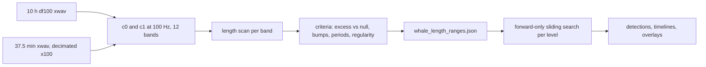

# Phase 1: motif length-range experiment; Phase 2: forward-only search

First, run a data-driven experiment on the 10-hour 2 kHz recording, using both c0 and c1, to find a suitable motif length range for each level (unit, phrase, theme, song). The criteria correct for the known bias toward short lengths. Then run the forward-only sliding-window search with those ranges. The 37.5-minute file serves as a cross-check.

## Tasks
- [ ] Extend `whale_mfcc.py`: fs-aware band edges (12 bands at 2 kHz), separate window/hop, `block_average`; compute cached 100 Hz c0/c1 features for the 10 h file and the decimated 37.5-minute file; verify the time offset of 014845 inside 193500
- [ ] Implement length-scan helpers: per-length NN correlation stats, block-shuffle null, detrended residuals, NN-offset/ACF period peaks, song-level copy regularity
- [ ] Build and run `Whale_Song_Length_Range_Experiment.ipynb` for unit/phrase/theme/song bands on c0 and c1; apply the decision rule; save `whale_length_ranges.json`
- [ ] Add `best_motif_in_window` and `forward_motif_search` (sliding, NaN blanking, lower-bound shift, rejected logging, CSV cache) to `whale_mfcc.py`
- [ ] Build and run `Whale_Song_Multiscale_Forward_Motifs.ipynb` using the discovered ranges on the 10 h file (and cross-check on the 37.5-minute file)
- [x] Copy the plan to `Whales_Song/Length_Range_and_Forward_Search_Plan.md` and mark `Multiscale_Forward_Motif_Plan.md` as superseded

## What we know
- **Main dataset:** `SOCAL_H_76_230426_193500_df100.x.x.wav`, 10 h, 2 kHz, 16-bit, with a `harp` chunk. It starts at 2023-04-26 19:35:00, so it should contain our 37.5-minute file (01:48:45) at an offset of about 22,425 s. A sanity-check cell will confirm this by cross-correlating the downsampled 014845 audio with the 10-hour file.
- **Prior knowledge:** songs are 10–20 min long (median 12.4; the PDF found a 12–14 min cycle) and units are 1–3 s. Phrase and theme lengths are unknown.
- **Lessons from the experiment PDF:**
  - "Most correlated pair" always picks the shortest length.
  - Choosing by PMP surface height picked lengths that were too long (17 min).
  - The useful evidence was a small bump in correlation versus length, and regular gaps between occurrences.
  - At 2 kHz, MATLAB's default band edges are cut at 1 kHz. That leaves 14 edges, 12 bands (133–1000 Hz), and at most 12 coefficients. The PDF's "coefficient 2" is **c1**.

## Features (both c0 and c1)
Extend `whale_mfcc.py` as follows:
- `matlab_band_edges(fs)` drops edges above `fs/2`, which reproduces the 12-band design at 2 kHz.
- `matlab_mfcc(..., window_sec, hop_sec)` gets a separate hop. The base features use a 0.1 s window (as in the PDF) and a 10 ms hop, giving 100 frames/s and 3.6M frames for 10 h. They are cached as float32 in `whale_mfcc_193500_100hz.npz` (columns: log energy, c0 ... c11).
- The 014845 file is decimated ×100 with `resample_poly` to 2 kHz, then gets the same features, so both files are comparable.
- `block_average(T, k)` produces the coarser rates used per band below.

## Phase 1: length-scan experiment
Each band uses a frame rate that keeps motif lengths between about 50 and 1,500 points, so every band runs in minutes. All matrix profiles use a non-overlapping exclusion zone (m/1).

| Band | Lengths scanned (log-spaced) | Rate | Data |
|---|---|---|---|
| unit | 0.3–8 s | 100 Hz | 12 ten-minute segments spread over the night |
| phrase | 5–120 s | 10 Hz | 3 one-hour segments |
| theme | 1–8 min | 2 Hz | full 10 h |
| song | 5–25 min, 1-min steps | 1 Hz | full 10 h |

For every length L, compute the matrix profile and convert each window's distance to the correlation with its best non-overlapping match, `r = 1 - d^2/(2L)`. Then apply these criteria:

1. **Excess repetition over a null (primary).** Compare the top-decile r of the real series with the same statistic on a *block-shuffled* copy. The shuffled copy cuts the series into blocks of L/4 and shuffles them, which keeps all structure shorter than L/4 but destroys structure at scale L. The excess `E(L) = r_real - r_null` removes the short-length bias. A natural length shows up as a peak in E(L).
2. **Detrended correlation bumps.** Fit a smooth trend (in log L) to the best-pair r and to the top-decile r, and look for positive residual peaks. This is the PDF's "bump at 14 min" criterion.
3. **Repetition period.** Histogram the nearest-neighbour offsets `|I[i] - i|` for strongly matching windows, and compute the autocorrelation of the feature across lags. Peaks give the repetition periods: units within phrases, phrases within themes, and the song cycle.
4. **Regularity (song level).** For the best motif at L, collect copies above an adaptive threshold, as in the PDF. Report the median gap between copies, the coefficient of variation of the gaps, the largest gap, and how much of the night they cover. A good song length gives regular gaps close to the song period, with no hole longer than about 1.5 cycles.

**Decision rule per level.**
- The suitable range is the set of lengths around the main E(L) peak within the band where `E >= 0.5 * peak`, i.e. its half-maximum width.
- The range is accepted if criterion 2 or 3 supports it (a residual bump or a period peak within or adjacent to the range).
- For the unit and song levels, the result is also checked against the priors (1–3 s; 10–20 min).
- The output is a table per level and feature (c0 or c1), saved to `whale_length_ranges.json`.

## Phase 2: forward-only search (as planned before, with the discovered ranges)
- Add `best_motif_in_window` and `forward_motif_search` (sliding window, NaN blanking, lower bound moved to the end of the earliest occurrence, rejected candidates logged) to `whale_mfcc.py`.
- The window is 15 times the longest length, capped at the file length. Ranges and frame rates are read from `whale_length_ranges.json`. Phase 2 runs on the 10-hour file for both features and is cross-checked on the 37.5-minute file.
- Outputs: a detections CSV per level, a timeline with one row per level, overlays of the strongest detections, and correlation histograms.

## Notebooks
- New `Whales_Song/Whale_Song_Length_Range_Experiment.ipynb` (Phase 1).
- New `Whales_Song/Whale_Song_Multiscale_Forward_Motifs.ipynb` (Phase 2).

## Notes
- **Runtime estimate:** MFCC for the 10-hour file takes about 1 minute. The Phase 1 scans take about 10–20 minutes per feature, including one null shuffle per length. Phase 2 is dominated by the unit level on the 10-hour file, likely 20–40 minutes per feature. Everything is cached.
- **Replication follow-up (out of scope here):** the PDF suggests the original figure used c1 rather than c0. The replication notebook could be re-run with `COEF_COLUMN = 3` (MATLAB's third column, which is c1 after log energy) as a follow-up.
