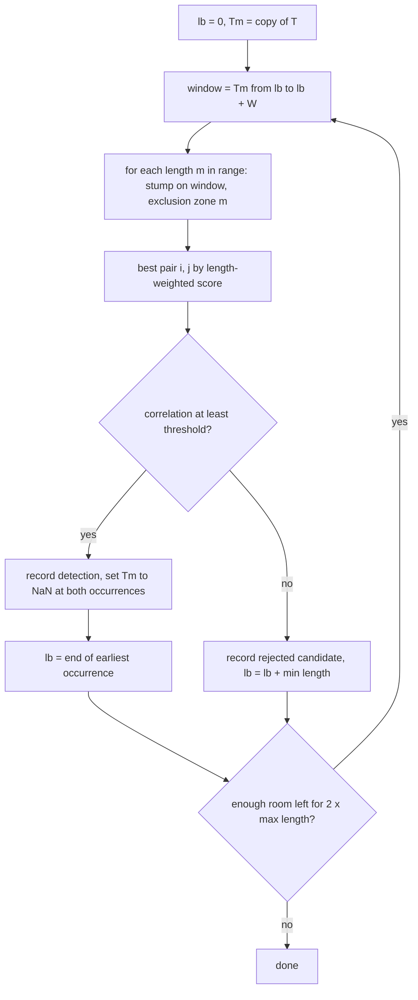

# Multi-scale forward-only motif search

> **Superseded** by [Length_Range_and_Forward_Search_Plan.md](Length_Range_and_Forward_Search_Plan.md): the motif length ranges are now found by an experiment first (units are 1-3 s and songs 10-20 min, not the ranges below), and the analysis uses the 10-hour recording.

Add a new notebook that searches the whole XWAV recording at four scales (units 5-10 s, phrases 30-60 s, themes 1-3 min, songs 5-10 min). For each scale, a forward-only sliding window finds the best repeated pair, blanks out (NaN) the detected chunks, and moves the window's lower bound past the earliest occurrence. The output is a list of detections per scale, with timelines and overlays.

## Tasks
- [ ] Add `block_average`, `best_motif_in_window`, `forward_motif_search` (with CSV caching and rejected-candidate logging) to `Whales_Song/whale_mfcc.py`
- [ ] Smoke-test `forward_motif_search` on the first 10 minutes for the unit level; check NaN masking, lower-bound shifting, and timing
- [ ] Build `Whale_Song_Multiscale_Forward_Motifs.ipynb`: `LEVELS` config, run all four levels, detections tables, 4-row timeline, overlays, correlation histograms, CSV export
- [ ] Execute the notebook end to end, review figures and thresholds, and summarize detections per level
- [x] Copy the plan to `Whales_Song/Multiscale_Forward_Motif_Plan.md`

## Decisions
- **Window movement: sliding.** The window always has length W and starts at the lower bound `lb`. After each detection:
  - Both occurrences are blanked out (set to NaN).
  - The lower bound moves to the end of the earliest occurrence.
  - The window slides forward, so the search only ever looks ahead.
- **Output: detections only.** No grouping into templates yet.
- **Window size: about 15 times the longest motif**, the same ratio as units (10 s in 2.5 min), capped at the whole file.

## Per-level settings
Each level is analyzed independently on the MATLAB-style c0 series cached in `whale_mfcc_matlab.npz`. The series is block-averaged down to a coarser frame rate per level so that every level runs in minutes rather than hours.

| Level | Motif lengths | Length step | Window W | Frame rate | Correlation threshold (tunable) |
|---|---|---|---|---|---|
| unit | 5-10 s | 0.5 s | 150 s | 50 Hz (20 ms) | 0.80 |
| phrase | 30-60 s | 2.5 s | 15 min | 10 Hz | 0.75 |
| theme | 1-3 min | 10 s | 37.5 min (capped) | 10 Hz | 0.70 |
| song | 5-10 min | 30 s | 37.5 min (capped) | 5 Hz | 0.60 |

Measured: `stumpy.stump` on a 15k-point window with NaN-masked chunks takes about 0.5 s. Subsequences that touch NaN correctly get infinite distance, so blanking works with stumpy as is.

## Algorithm (one level)

- Both occurrences must lie inside the current window and must not overlap (exclusion zone = m).
- Ranking across lengths uses the length-weighted score from the replication notebook. The threshold is applied to the pair's Pearson correlation `1 - d^2/(2m)`.
- Rejected best candidates are also logged, so you can retune the thresholds from the correlation distribution.

## Code changes
- Extend `Whales_Song/whale_mfcc.py` with:
  - `block_average(T, factor)`: downsample the 100 Hz series to the level's frame rate (NaN-aware).
  - `best_motif_in_window(Tw, ms, max_m)`: run `stumpy.stump` for each `m`, then use `motif_strength(..., "weighted")` to return the best `(m, i, j, d)` or `None`. Its `config.STUMPY_EXCL_ZONE_DENOM = 1` setting is restored afterwards.
  - `forward_motif_search(T, fr, min_sec, max_sec, step_sec, window_sec, threshold, cache_path)`: the loop above. It returns a `pandas.DataFrame` with columns `level, iteration, accepted, lb_min, window_end_min, length_s, start1_min, start2_min, correlation`. Results are cached to CSV so re-runs are instant.
- New notebook `Whales_Song/Whale_Song_Multiscale_Forward_Motifs.ipynb`:
  1. Explain the unit/phrase/theme/song hierarchy, the forward-only rule, and the settings table (as a `LEVELS` dict at the top so it is easy to edit).
  2. Load the cached MFCC and take `T = coeffs[:, 1]`.
  3. For each level, run `forward_motif_search` with a progress print and cache it to `whale_forward_<level>.csv`. Show the accepted detections table and counts.
  4. Plot a timeline with four rows (one per level) across the 37.5 minutes: occurrence 1 and occurrence 2 of each detection as coloured spans, joined by a thin arc or line.
  5. For each level, show z-normalized overlays of the 3 strongest detections.
  6. Plot correlation histograms of accepted and rejected candidates per level, with the threshold marked, to guide retuning.
  7. Export all detections to `whale_forward_detections.csv`.

## Expected runtime
- Unit level: at most about 450 iterations of 11 lengths on a 7.5k-point window, roughly 10-20 minutes.
- Phrase, theme and song levels: a few minutes each.
- Total: under about 30 minutes for the first run; later runs load the cached results instantly.
