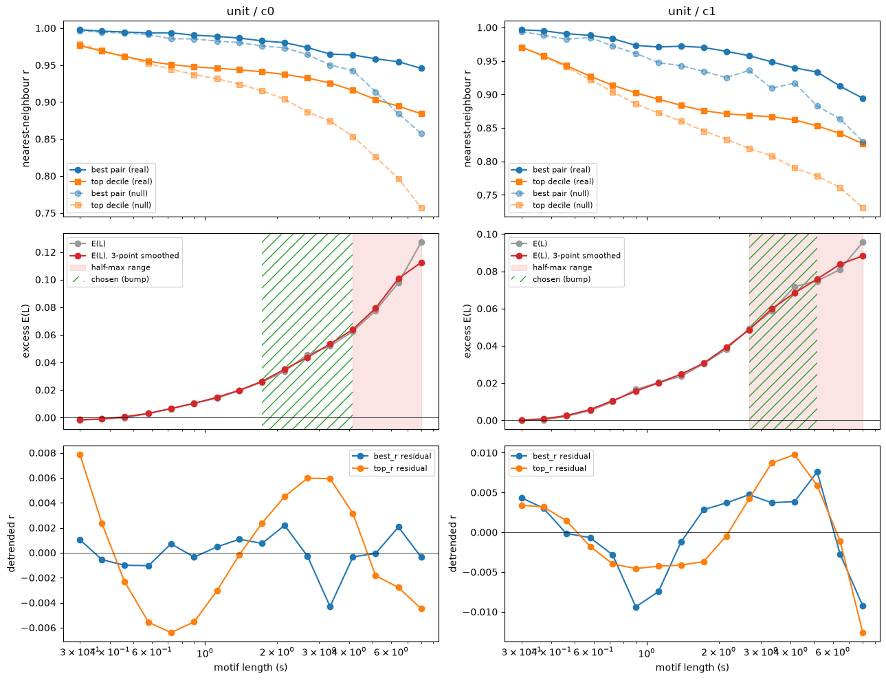
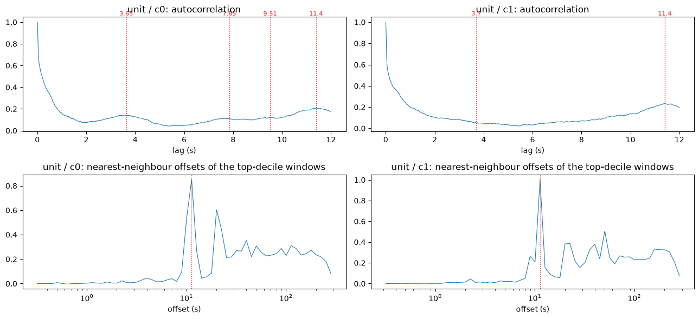
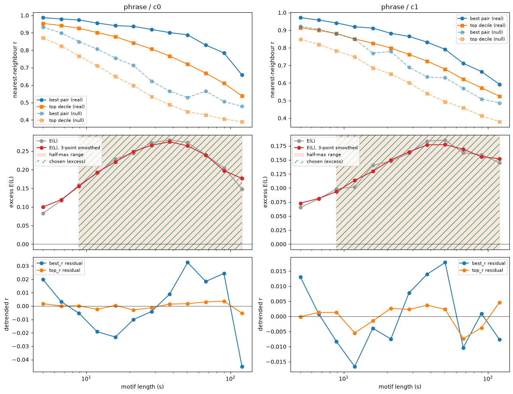
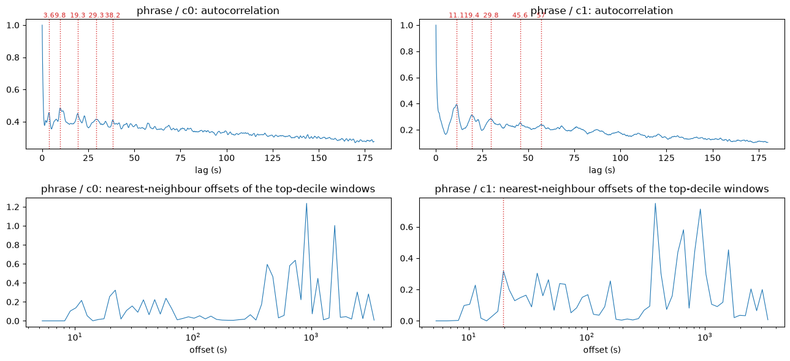
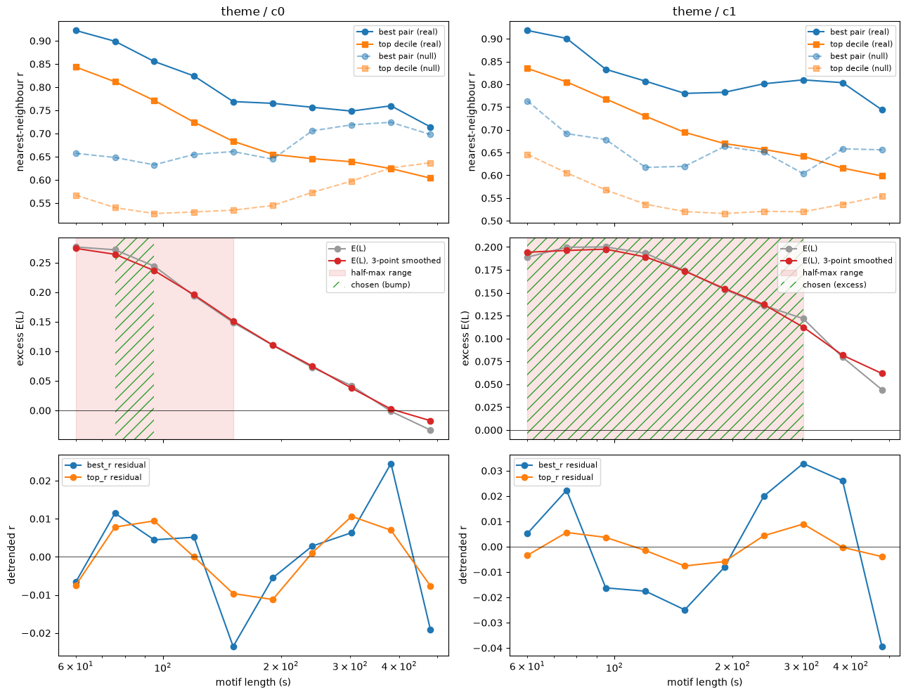
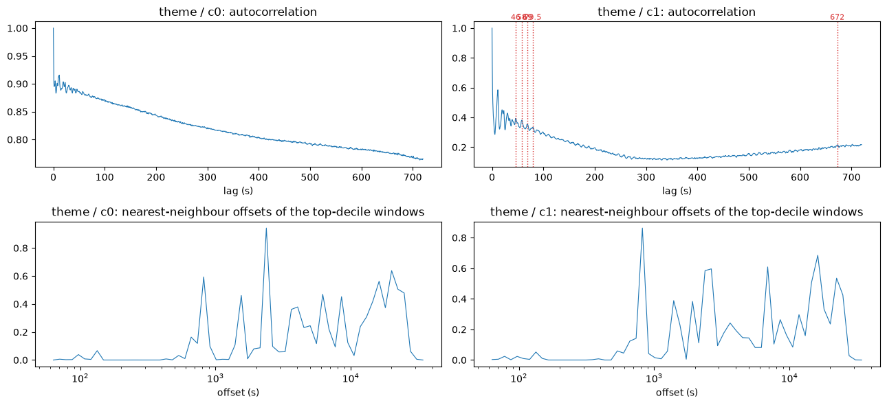
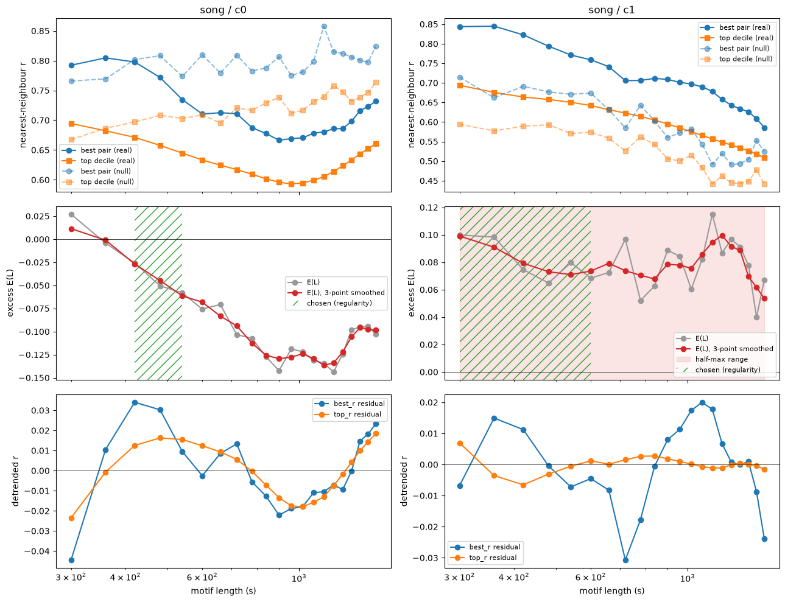
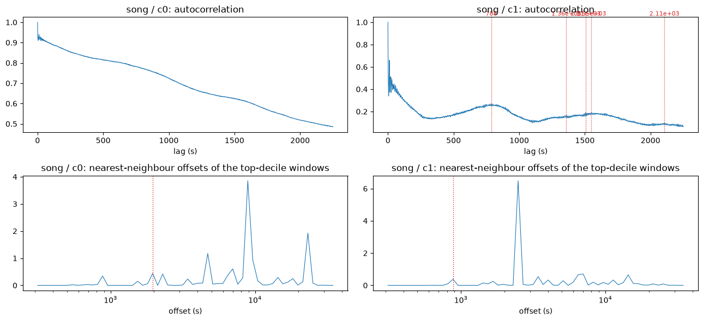
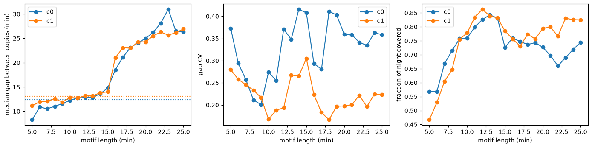

# Phase 1 report: natural motif lengths in the humpback whale song

Notebook: [`Whale_Song_Length_Range_Experiment.ipynb`](../Whale_Song_Length_Range_Experiment.ipynb) ·
Plan: [`Length_Range_and_Forward_Search_Plan.md`](../Length_Range_and_Forward_Search_Plan.md) ·
Output: [`whale_length_ranges.json`](../whale_length_ranges.json)

## Summary

The experiment measures, for motif lengths from 0.3 s to 25 min, how much more the whale song repeats itself than
a random signal with the same spectrum would. It does this for the four levels of humpback song (unit, phrase,
theme, song) and for two MFCC coefficients (c0: overall band energy; c1: spectral tilt, the PDF's "coefficient 2").

| level | c0 range | c1 range | decided by |
|---|---|---|---|
| unit | 1.7–4.2 s | 2.7–5.2 s | bump in the detrended correlation (overlaps the 1–3 s prior) |
| phrase | 8.9–120 s (peak 38 s) | 8.9–120 s (peak 50 s) | half-maximum width of the excess over the null |
| theme | 75–95 s | 60–300 s (peak 95 s) | bump (c0); excess over the null (c1) |
| song | 7–9 min | 5–10 min | copies of the motif recur once per song cycle |

Main findings:

- **Phrase period ≈ 11 s.** The sharpest regularity in the recording: a few-second chunk's best match is usually
  11.3 s later (both coefficients), with autocorrelation peaks at ~10–11 s and its multiples (~20, ~30, ~40 s).
- **Repetition is strongest for ~40–100 s chunks.** Across all bands the excess over the null has one broad
  maximum there, which corresponds to several repeated phrases (themes).
- **Song cycle ≈ 13 min.** c1's autocorrelation peaks at 788 s (13.1 min), and 5–10 min motifs recur every
  11–13 min with regular gaps, matching the PDF's 12–14 min cycle and the 10–20 min prior.
- **c1 is the better coefficient for long motifs.** c0 is dominated by slow loudness changes and shows no excess
  repetition at song lengths.
- **Alignment.** The 37.5-minute file `SOCAL_H_76_230427_014845` starts exactly **22,424.5 s** (6 h 13 min 44.5 s)
  into the 10-hour file; the features of the two files agree with r = 0.997 (c0) and 0.996 (c1).

## Data and features

- **Recording:** `SOCAL_H_76_230426_193500_df100.x.x.wav`, 10 h at 2 kHz, starting 2023-04-26 19:35:00.
- **Features:** MATLAB-style MFCC at 2 kHz: 12 mel bands from 133 Hz to 1 kHz (MATLAB's default band edges cut at
  the 1 kHz Nyquist), 0.1 s Hamming window, 10 ms hop, i.e. **100 frames/s** and 3.6 million frames. Columns:
  log energy, c0, c1, …, c11. Cached in `whale_mfcc_193500_100hz.npz`.
- **37.5-minute file:** the original 200 kHz recording, decimated ×100 to 2 kHz and given the same features
  (`whale_mfcc_014845_100hz.npz`). It is located inside the 10-hour file by cross-correlating the raw 2 kHz audio
  at three probe points (all give 22,424.5 s, audio r = 1.000).

## Method

### Bands

Each level is scanned at a frame rate that keeps motif lengths between ~30 and ~1,500 points. All matrix profiles
use an exclusion zone of the full window length, so a window's best match never overlaps it.

| level | lengths scanned | rate | data |
|---|---|---|---|
| unit | 0.3–8 s, 16 log-spaced | 100 Hz | 8 × 5-min segments spread over the night |
| phrase | 5–120 s, 12 log-spaced | 10 Hz | 3 × 1-h segments (start, middle, end) |
| theme | 60–480 s, 10 log-spaced | 2 Hz | full 10 h |
| song | 300–1500 s, 1-min steps | 1 Hz | full 10 h |

### Criteria

For each length *L*, the matrix profile (`stumpy.stump`) gives every window's correlation with its best
non-overlapping match, *r* = 1 − *d*²/(2*L*).

1. **Excess repetition over a null (primary).** *E(L)* = top-decile *r* of the data − top-decile *r* of a
   *phase-randomized surrogate* (same power spectrum, so the same smoothness and the same bias toward short
   lengths, but no repeated shapes). A natural motif length shows up as a peak of *E(L)*.
2. **Detrended correlation bumps.** A quadratic trend in log *L* is removed from the best-pair and top-decile *r*;
   positive bumps are the PDF's "bump" criterion.
3. **Repetition periods.** Peaks of the autocorrelation and of the histogram of offsets between strongly matching
   windows and their nearest neighbours.
4. **Regularity (song level).** For the best pair at each length, copies are collected as in the PDF (threshold
   lowered until no gap longer than 20 min remains). A good song length has copies recurring once per song period
   (± 25%), gap coefficient of variation ≤ 0.3 and no hole longer than 1.5 periods.

### Decision rule

*E(L)* is smoothed over 3 neighbouring lengths, and the range is its half-maximum width around the peak. It is
accepted if the peak excess is ≥ 0.02, the peak is **localized** (not at the first or last length of the band and
the range does not span the whole band) and a bump or a period supports it. Otherwise:

- song level: the regularity criterion decides;
- other levels: the positive part of the detrended top-decile bump with the largest excess;
- if nothing applies, the initial guess is used (this did not happen).

The **threshold** for Phase 2 is the null's top-decile correlation at each length: a detection must be at least as
similar as the best 10% of chance matches.

### Changes from the plan

- **Null model.** The planned block-shuffled null was replaced by the phase-randomized surrogate. The jumps where
  shuffled blocks join made the shuffled c0 series *more* self-similar than the real one (null top-decile r ≈ 0.96).
- **Localized peak required.** In the unit band, *E(L)* keeps rising up to the 8 s edge, so the plain half-maximum
  rule picked 4–8 s, which is just the edge of the scan. The localization requirement and the bump fallback were
  added for this case.

## Results by level

### Units (0.3–8 s)

*E(L)* rises steadily from 0 at 0.3 s to 0.13 (c0) and 0.10 (c1) at 8 s: longer chunks repeat increasingly more than
chance, but there is no peak inside the band. The detrended top-decile correlation has a clear bump around
**2.7 s (c0)** and **4.2 s (c1)**, and the positive part of that bump gives the unit ranges 1.7–4.2 s and
2.7–5.2 s. Both overlap the 1–3 s prior; a motif window includes the unit plus some of the gap around it.

The offset histogram has a very sharp peak at **11.3 s** for both coefficients (and a second one at ~20–22 s): the
best match of a strongly repeating few-second chunk is usually one phrase later. The autocorrelation also peaks at
11.4 s, with weaker peaks at 3.6–3.7 s (c0 also 7.9 and 9.5 s), consistent with units repeating within a phrase.

### Phrases (5–120 s)

*E(L)* has a clear interior maximum: **0.28 at 38 s (c0)** and **0.19 at 50 s (c1)**. The half-maximum range covers
8.9–120 s for both, supported by correlation bumps (c0: 15.9, 50, 90 s; c1: 8.9, 21, 38, 50, 90 s) and by periods.

| L (s) | 5 | 8.9 | 15.9 | 28.3 | 37.8 | 50.4 | 67.3 | 120 |
|---|---|---|---|---|---|---|---|---|
| E, c0 | 0.08 | 0.16 | 0.23 | 0.27 | **0.28** | 0.27 | 0.24 | 0.15 |
| E, c1 | 0.07 | 0.10 | 0.14 | 0.16 | 0.18 | **0.19** | 0.16 | 0.15 |

The autocorrelation has a comb of peaks at **~10–11 s and its multiples** (c0: 9.8, 19.3, 29.3, 38.2 s; c1: 11.1,
19.4, 29.8, 45.6, 57 s). This is the signature of phrases of ~10–11 s repeated several times in a row. The excess
maximum at 40–50 s therefore covers about four repeated phrases.

### Themes (1–8 min)

- **c0:** *E(L)* is largest at the shortest length (0.28 at 60 s) and falls to zero by ~6 min, i.e. it continues
  the phrase-band maximum. With no interior peak, the bump at 75–95 s decides.
- **c1:** a flat-topped maximum of 0.20 at 75–95 s, half-maximum range 60–300 s, supported by bumps at 75 and
  300 s and by autocorrelation peaks at 46–80 s (still the ~11 s phrase comb).

At this scale, c0's autocorrelation decays slowly from 0.9 (slow loudness changes). The offset histograms peak at
**~820 s (13.6 min)** for both coefficients (c0's strongest peak is at ~2,400 s, about three cycles; the histogram
bins are ~11% wide). The best match of a strongly repeating theme is usually the same theme in the next song.

### Songs (5–25 min)

- **c0:** the surrogate matches as well as or better than the data at every song length (*E* from +0.03 at 5 min
  down to −0.14). c0's slow loudness changes, which the surrogate keeps, dominate at this scale.
- **c1:** *E(L)* is positive but flat (0.04–0.12) across the band, so the half-maximum range spans everything and
  the excess criterion cannot pick a length.

c1's autocorrelation peaks at **788 s (13.1 min)** and again near 1,500 s (two cycles); c0 has no peaks. The
regularity criterion therefore decides, using 13.1 min for c1 and the 12.4 min prior median for c0:

| c1 motif length | 5 min | 6 min | 7 min | 8 min | 9 min | 10 min | 11 min | 12 min | 16 min |
|---|---|---|---|---|---|---|---|---|---|
| copies | 56 | 53 | 52 | 49 | 51 | 47 | 46 | 44 | 29 |
| median gap (min) | 11.1 | 12.0 | 12.1 | 12.6 | 11.9 | 12.8 | 12.8 | 13.2 | 21.0 |
| gap CV | 0.28 | 0.26 | 0.25 | 0.23 | 0.22 | 0.17 | 0.19 | 0.19 | 0.22 |
| longest hole (min) | 15.8 | 17.3 | 17.3 | 18.5 | 20.3 | 17.5 | 20.8 | 20.8 | 27.9 |
| regular | yes | yes | yes | yes | no | yes | no | no | no |

Up to ~15 min, copies recur every 11–14 min; above 15 min the gap jumps to ≥ 21 min (two cycles), because a
motif longer than one song cycle can no longer find a copy in every cycle. The c1 regular lengths are 5–10 min
(9 min narrowly fails on its 20.3 min hole). For c0, 7–9 min pass (gaps 10.5–11.6 min, CV 0.20–0.26); c0 at
10–15 min has very irregular gaps (CV 0.26–0.42) and holes of 30–51 min.

The chosen song motif lengths (5–10 min) are shorter than the full song (10–20 min). That is expected: a motif of
about half a cycle is long enough to be unique to the song but short enough to be found in every cycle.

## Caveats

- The excess criterion only resolves the phrase/theme scale. Units and songs are decided by the secondary
  criteria (bumps and regularity), which are noisier.
- The phrase range (8.9–120 s) is wide, because *E(L)* has a broad maximum. The Phase 2 search ranks lengths inside
  it by their excess, so it is not forced to the shortest length.
- Unit and phrase bands are scanned on segments (40 min and 3 h of the 10 h), so rare phrase types may be missed.
- The surrogate keeps the spectrum but not the non-stationarity (singing vs. silence). Part of the excess at long
  lengths may come from the on/off structure of singing bouts rather than from song content.

## Reproducing

- Run the notebook from the `Whales_Song` folder. The first run takes ~20 minutes on a 32-core CPU (MFCC features
  ~1 min, unit scans ~9 min, the rest ~10 min). Results are cached (`whale_scan_<level>_<feature>.csv`,
  `whale_scan_<level>_<feature>_offsets.npz`, `whale_song_regularity_<feature>.csv`), so re-runs take ~15 s.
- Helpers live in [`whale_mfcc.py`](../whale_mfcc.py): `load_or_compute_features`, `find_offset`, `length_scan`,
  `phase_surrogate`, `detrended_residual`, `autocorrelation`, `period_peaks`, `offset_histogram`,
  `song_regularity`, `regular_range`, `choose_range`, `bump_range`.
