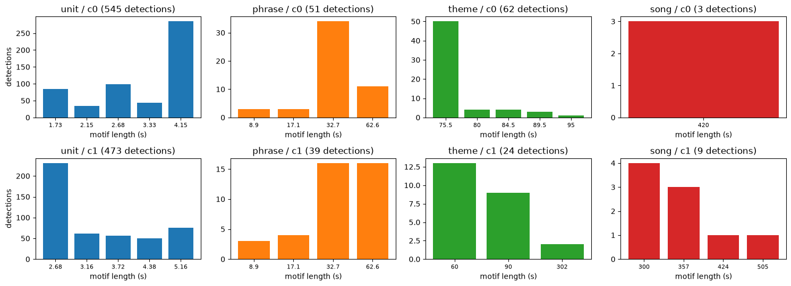
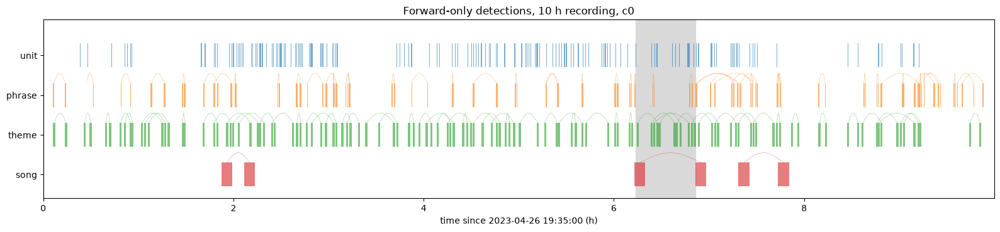
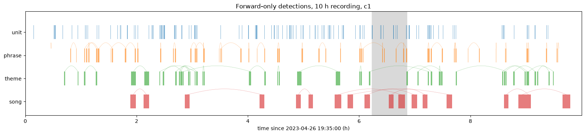
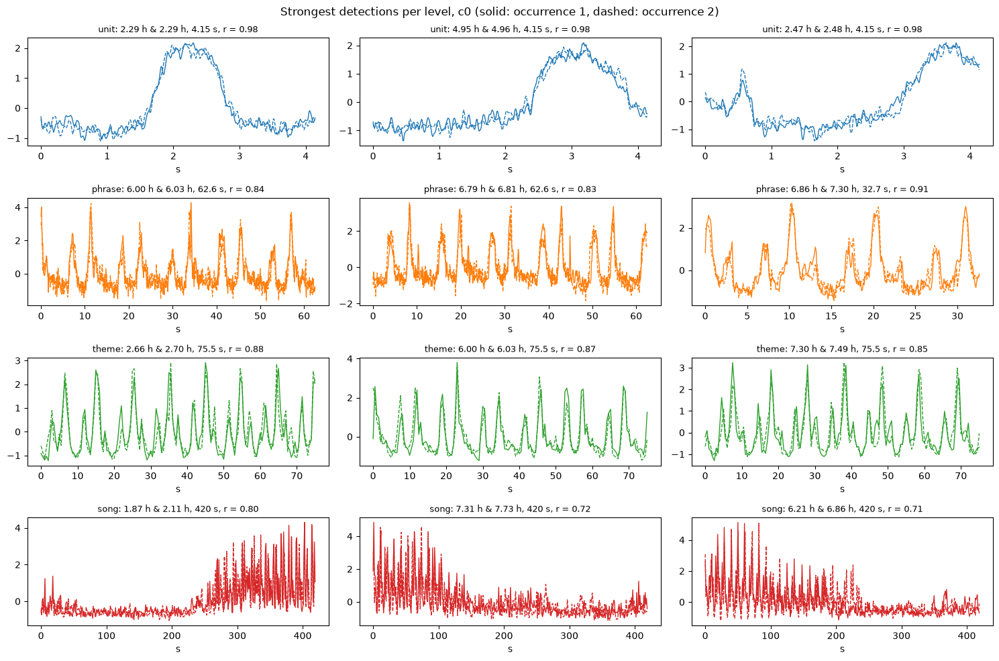
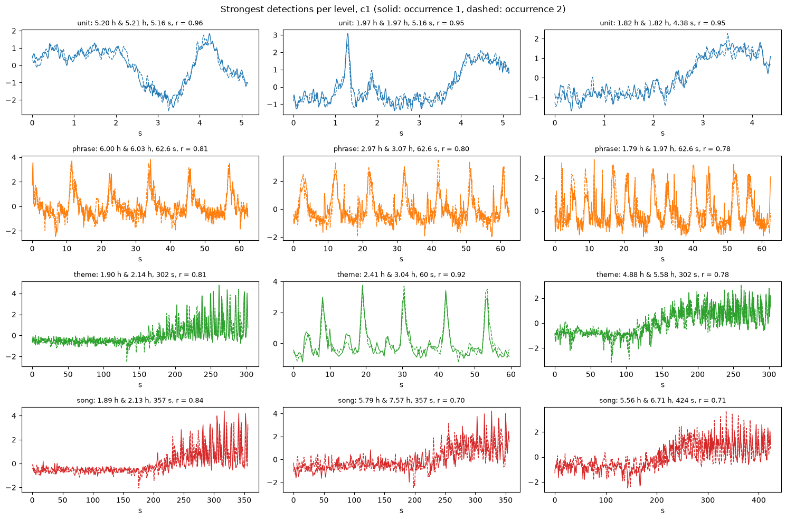
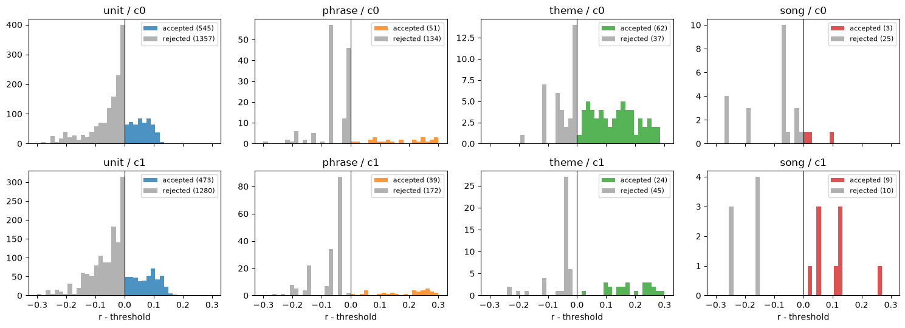
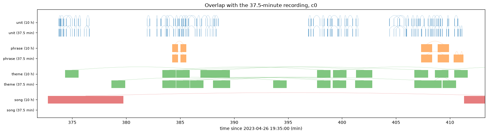
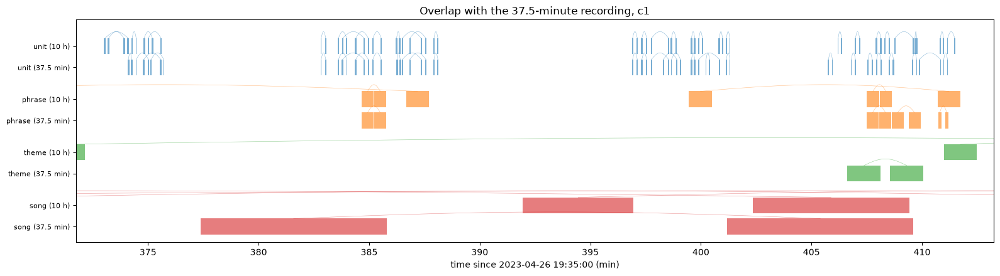

# Phase 2 report: forward-only motif search at four levels

Notebook: [`Whale_Song_Multiscale_Forward_Motifs.ipynb`](../Whale_Song_Multiscale_Forward_Motifs.ipynb) ·
Plan: [`Length_Range_and_Forward_Search_Plan.md`](../Length_Range_and_Forward_Search_Plan.md) ·
Input: [`whale_length_ranges.json`](../whale_length_ranges.json) (from the
[Phase 1 report](Phase1_Length_Range_Report.md)) ·
Output: [`whale_forward_detections.csv`](../whale_forward_detections.csv)

## Summary

The 10-hour recording was searched for repeated motifs at the unit, phrase, theme and song levels with a
forward-only sliding window, using the Phase 1 length ranges, on both MFCC coefficients (c0 and c1). The
37.5-minute recording, which lies inside the 10-hour one, was searched independently as a cross-check.

| level | detections in 10 h (c0 / c1) | typical length | median r (c0 / c1) | occurrences typically apart |
|---|---|---|---|---|
| unit | 545 / 473 | 3–4 s | 0.93 / 0.88 | ~13 s (one phrase) |
| phrase | 51 / 39 | 33–63 s | 0.80 / 0.78 | 1.6–2.5 min |
| theme | 62 / 24 | 60–90 s | 0.68 / 0.81 | 11–21 min (about one song cycle) |
| song | 3 / 9 | 5–7 min | 0.72 / 0.70 | 25–48 min |

Main findings:

- **Units are found reliably.** About 50 detections per hour, nearly identical occurrence pairs (r up to 0.98),
  and **73–83% of the unit detections of the independent 37.5-minute search are found again** by the 10-hour search,
  against 9–13% by chance.
- **Unit repeats are one phrase apart.** The two occurrences of a unit detection are typically ~13 s apart, which
  matches the ~11 s phrase period found in Phase 1.
- **Phrase and theme detections show repeated phrases.** The strongest ones are trains of peaks every ~7–11 s that
  line up in both occurrences: several repetitions of the same phrase, i.e. theme structure.
- **The song level does not work yet.** Only 3 and 9 detections, and the strongest ones match the transition
  between silence and singing rather than song content.
- **The threshold only limits units and songs.** At the phrase level (and the c1 theme level), every window before
  the end of the recording produced a detection; all rejections are in the final windows.

## Method

### Forward-only rule

For each level, a window of length *W* = 15 × (longest motif length), capped at the recording, starts at a lower
bound `lb`:

1. Find the best repeated pair inside `[lb, lb + W)` over 5 log-spaced lengths of the level's range
   (`stumpy.stump`, exclusion zone = the full length, so the two occurrences never overlap).
2. If it reaches the threshold, it is a **detection**: both occurrences are **blanked** (set to NaN, so no later
   window can use them) and `lb` moves to the **end of the earlier occurrence**.
3. Otherwise it is logged as **rejected** and `lb` moves by the shortest length.

The search never looks back. The audio between the old lower bound and a detection's first occurrence is never
searched again.

### Ranking and threshold

Shorter windows always correlate better. Candidates of different lengths are therefore ranked by their **excess**
correlation over the Phase 1 null at their own length (*r* − null top-decile *r*(*L*)), and a detection must
reach that null level. Ranking by plain correlation or with a single threshold put every phrase detection at the
shortest length (8.9 s) in a test.

### Skipping runs of rejections

After a rejection, the search checks a window twice as long. If no pair in it reaches the threshold, every
sliding window inside it would be rejected too, so they are skipped in one step and logged as one row
(`skipped` > 1). A test on 10 minutes of data gave identical detections with and without the shortcut. It saved
most of the work at the unit level (c0: 11,594 window positions in 1,902 computations).

### Settings

| feature | level | range (s) | from | rate | window *W* | lengths (s) | threshold r |
|---|---|---|---|---|---|---|---|
| c0 | unit | 1.73–4.15 | bump | 100 Hz | 1.0 min | 1.73, 2.15, 2.68, 3.33, 4.15 | 0.92 … 0.85 |
| c0 | phrase | 8.9–120 | excess | 10 Hz | 30 min | 8.9, 17.1, 32.7, 62.6, 120 | 0.77 … 0.39 |
| c0 | theme | 75.5–95 | bump | 2 Hz | 24 min | 75.5, 80, 84.5, 89.5, 95 | 0.54 … 0.53 |
| c0 | song | 420–540 | regularity | 1 Hz | 135 min | 420, 447, 476, 507, 540 | 0.70 … 0.71 |
| c1 | unit | 2.68–5.16 | bump | 100 Hz | 1.3 min | 2.68, 3.16, 3.72, 4.38, 5.16 | 0.82 … 0.78 |
| c1 | phrase | 8.9–120 | excess | 10 Hz | 30 min | 8.9, 17.1, 32.7, 62.6, 120 | 0.78 … 0.38 |
| c1 | theme | 60–302 | excess | 2 Hz | 76 min | 60, 90, 134, 202, 302 | 0.65 … 0.52 |
| c1 | song | 300–600 | regularity | 1 Hz | 150 min | 300, 357, 424, 505, 600 | 0.59 … 0.57 |

## Results

### Detection counts (10-hour recording)

| feature | level | windows examined | logged rows | detections | per hour | median length (s) | median r | median gap between occurrences (min) | fraction of night covered |
|---|---|---|---|---|---|---|---|---|---|
| c0 | unit | 11,594 | 1,902 | 545 | 54.5 | 4.15 | 0.933 | 0.21 | 10% |
| c1 | unit | 7,068 | 1,753 | 473 | 47.3 | 3.16 | 0.884 | 0.23 | 9% |
| c0 | phrase | 185 | 185 | 51 | 5.1 | 32.7 | 0.798 | 2.53 | 10% |
| c1 | phrase | 211 | 211 | 39 | 3.9 | 32.7 | 0.775 | 1.63 | 9% |
| c0 | theme | 99 | 99 | 62 | 6.2 | 75.5 | 0.682 | 11.1 | 27% |
| c1 | theme | 69 | 69 | 24 | 2.4 | 60 | 0.808 | 21.2 | 12% |
| c0 | song | 48 | 28 | 3 | 0.3 | 420 | 0.722 | 25.1 | 7% |
| c1 | song | 19 | 19 | 9 | 0.9 | 357 | 0.695 | 47.8 | 18% |

### Which lengths win

With excess ranking, the lengths spread over each range instead of piling up at the shortest one:

- **Units:** c0 prefers the longest length (4.15 s), c1 the shortest (2.68 s).
- **Phrase:** mostly 32.7 s and 62.6 s; never 120 s.
- **Theme:** mostly the shortest length (c0: 75.5 s; c1: 60 s).
- **Song:** short lengths (c0: 420 s; c1: 300–357 s).

### Timelines

Each detection is drawn as two spans (its occurrences) joined by an arc; the grey band is the 37.5-minute recording.
Unit detections come in dense clusters separated by empty stretches (the longest: 7.75–8.46 h, 0.94–1.58 h and
3.09–3.71 h for c0; 7.74–8.46 h for c1),
which presumably are pauses in singing or different song material. Phrase and theme detections are spread over the
whole night, because every window produces one (see the thresholds section below).

### Strongest detections

Both occurrences are z-normalized and overlaid (solid: first, dashed: second).

- **Units:** a 4.15 s c0 shape at 2.29 h is matched 11.3 s later with r = 0.98 (one phrase later); similar pairs
  at 4.95 h (also 11.3 s apart) and 2.47 h.
- **Phrase:** 33–63 s motifs (e.g. c0 at 6.00 h and 6.03 h, r = 0.84) show a train of peaks every ~7–11 s that lines
  up in both occurrences.
- **Theme:** the same repeated-phrase pattern, e.g. c0 75.5 s at 2.66 h and 2.70 h (r = 0.88), and c1 60 s at
  2.41 h and 3.04 h (r = 0.92).
- **Song:** the strongest matches (c0 420 s at 1.87 h and 2.11 h, r = 0.80; c1 357 s at 1.89 h and 2.13 h,
  r = 0.84) are about 14 min apart, close to one song cycle. But their shape is dominated by a quiet stretch
  followed by loud singing (or the reverse). Z-normalized correlation over 5–10 minutes is driven by that large
  loudness change, not by the sequence of themes.

### Thresholds: accepted and rejected candidates

| level | rejected (c0 / c1) | of which in the final windows of the recording |
|---|---|---|
| unit | 1,357 / 1,280 | 35 / 28 |
| phrase | 134 / 172 | 134 / 170 |
| theme | 37 / 45 | 10 / 45 |
| song | 25 / 10 | 0 / 0 |

- **Units:** the threshold is the active filter. More than half of the rejected candidates (62% for c0, 53% for c1)
  lie within 0.05 below it, and accepted ones lie up to 0.13 (c0) and 0.18 (c1) above it.
- **Phrase, c1 theme:** every window before the end of the recording yielded a detection, mostly 0.1–0.3 above
  the threshold. The rejections are all at the end of the file: once the window can no longer slide, `lb` creeps
  forward by the shortest length and no skipping is possible. The null threshold is therefore too lenient to
  filter at these levels. Detections should be judged by their correlation instead (the overlays above are
  convincing).
- **Song:** 3 of 28 (c0) and 9 of 19 (c1) candidates pass, several of them only barely.

### Cross-check with the 37.5-minute recording

In each pair of rows, the upper row shows the 10-hour search inside the overlap and the lower row the independent
search on the 37.5-minute file, shifted to the same clock. A 37.5-minute detection counts as matched if both of its
occurrences overlap occurrences of 10-hour detections of the same feature and level. The 10-hour coverage is the
chance level.

| feature | level | 37.5-min detections | 10-h detections inside | matched | chance (10 h coverage) |
|---|---|---|---|---|---|
| c0 | unit | 48 | 44 | **83%** | 13% |
| c0 | phrase | 4 | 2 | 50% | 8% |
| c0 | theme | 6 | 4 | 83% | 28% |
| c0 | song | 0 | 0 | – | 0% |
| c1 | unit | 30 | 27 | **73%** | 9% |
| c1 | phrase | 4 | 2 | 75% | 6% |
| c1 | theme | 1 | 0 | 0% | 0% |
| c1 | song | 1 | 0 | 0% | 0% |

- **Units are reproducible.** The two searches find the same clusters at the same times (373–376, 382–388, 397–402
  and 405–411 min), despite starting from different lower bounds.
- **Phrase and theme detections partly coincide** (e.g. c0 phrases at ~385 and ~408 min, c0 themes at 384–386 and
  398–403 min), but there are too few to quantify.
- **Song:** the window is capped at the 37.5-minute file, so the search effectively compares two halves of one
  song cycle; the levels are not comparable.

## Limitations

- **Song level.** Matches are driven by loudness changes at the start or end of singing bouts. Removing the slow
  loudness trend (or restricting the search to stretches where the whale sings) is needed before song-level
  templates can be trusted.
- **The forward rule leaves gaps.** Each detection pushes the lower bound past its earlier occurrence, so material
  between the old lower bound and that occurrence is never searched. With long windows (theme: 24–76 min, song:
  2.3–2.5 h), each level yields only one detection per window. That keeps theme and song detections sparse, and
  only 7–27% of the night ends up inside a detection.
- **Thresholds at the phrase and theme levels are not selective** (see above). A stricter null statistic (e.g. the
  null's best-pair correlation within a window of the same size) would make rejections meaningful there.
- **Detections only.** Detections are not yet grouped into templates (e.g. "unit type A occurs 120 times").

## Next steps

1. Cluster the unit detections by shape (e.g. with `stumpy.mpdist` or correlation) to obtain unit templates, and
   then phrase templates as sequences of units.
2. Detrend the loudness (or use c1 only within singing bouts) and re-run the song level.
3. Calibrate the phrase and theme thresholds with a window-matched null.

## Reproducing

- Run the Phase 1 notebook first (it writes `whale_length_ranges.json` and the scan CSVs used for the thresholds),
  then this notebook from the `Whales_Song` folder.
- The first run takes ~1.5 hours on a 32-core CPU: the unit level is ~35–41 minutes per feature, the other levels
  a few minutes, and the 37.5-minute file ~6 minutes. Results are cached in
  `whale_forward_<level>_<feature>_<file>.csv` (one row per accepted or rejected candidate). An interrupted run
  resumes from `*.partial.csv`, and re-runs take ~20 s.
- Helpers in [`whale_mfcc.py`](../whale_mfcc.py): `forward_level`, `forward_motif_search`, `best_motif_in_window`,
  `null_threshold`, `block_average`.
- `whale_forward_detections.csv` lists all 1,300 detections (both features, both recordings), with times on the
  10-hour clock in `start1_10h_min` and `start2_10h_min`.
